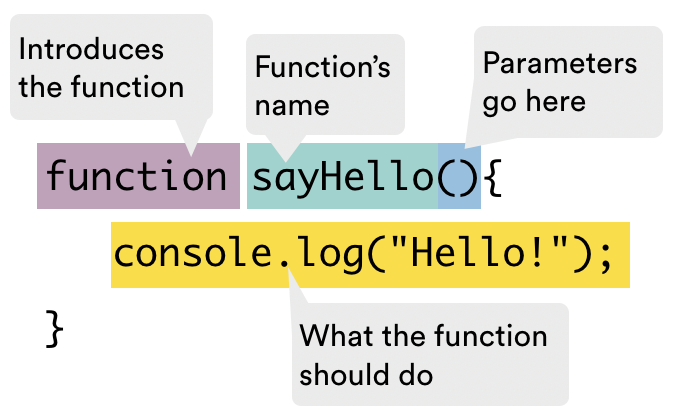
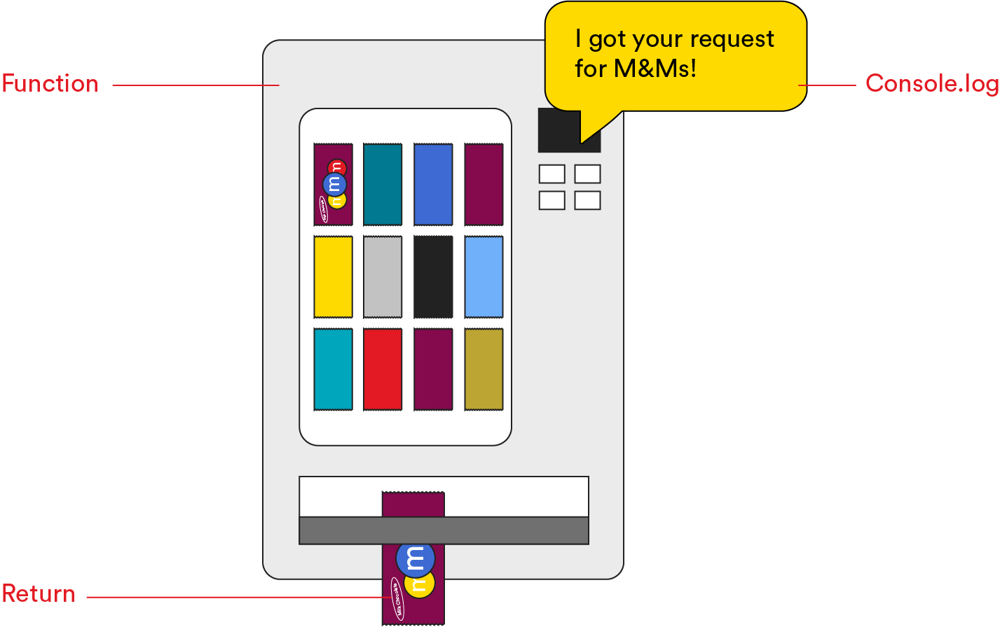

<textarea id="source">

<h1 class="slide-header">Functions</h1>

<span id=time-estimate class="color-grey-500">60 mins</span>

<p id="lesson-description">
One common mistake when writing code is copying and pasting the same lines of code in different places. This makes your code hard to manage and easy to break if you need to make changes later.

That’s where <strong>functions</strong> come in. A function is a <strong>block of strong</strong> that performs a specific task. Instead of repeating strong, you can write it once inside a function and then <strong>use (or "call") the function whenever you need it</strong>.

In this lesson, you’ll learn how to write functions and use them to make your strong more <strong>organized, efficient, and easy to reuse</strong>.

</p>

<h5 id="topics-header" class="color-grey-500">Topics</h5>

Writing Functions

<hr>

Function Inputs and Outputs

<hr>

Scope in JavaScript

<hr>

---

<h1 class="slide-header">Learning Objectives</h1>

<p>By the end of this lesson, you'll be able to:</p>

<ul>
  <li>Write and execute functions.</li>
  <li>Provide input for functions using parameters and arguments.</li>
  <li>Use return statements to store a function’s output.</li>
</ul>

---

<h1 class="slide-header">You Could Write Logic Like This...</h1>

Imagine you’re building a video game where a character collects different items — food, coins, and tools. Each time an item is collected, you need to update their points and add the item to their inventory.

Without functions, you might end up writing repetitive code like this:

```javascript
if (collectedFood === true) {
  player.points += 20;
  player.inventory.push('food');
} else if (collectedCoin === true) {
  player.points += 10;
  player.inventory.push('coin');
} else if (collectedTool === true) {
  player.points += 50;
  player.inventory.push('tool');
}
```

...and so on.

If you decide to change how points or inventory handling works, you'd have to update the same logic in multiple places. This makes your code **harder to manage and more prone to mistakes**.

Using functions helps avoid this problem.

---

<h1 class="slide-header">...But This is Better</h1>

Instead of repeating code, we can **wrap the logic in a function**:

```javascript
function collectItem(itemName, pointsValue) {
  player.points += pointsValue;
  player.inventory.push(itemName);
}
```

Now, whenever the player collects an item, just call the function and pass in the item name and points value:

```javascript
collectItem('food', 20);
collectItem('coin', 10);
collectItem('tool', 50);
```

This way, if you need to change the points or how items are tracked, you only have to update the function **once**. It keeps your code **clean, flexible, and easy to update**.

---

<h1 class="slide-header">The Need for DRY Code</h1>

Functions help us organize our code and avoid repeating ourselves. This follows an important programming principle called **DRY**: **D**on’t **R**epeat **Y**ourself.

When you follow DRY principles:

- Your code is **easier to maintain**.
- It’s **more efficient**.
- It’s **clearer and easier to read**.
- It’s **less prone to errors**.

In short, DRY code is clean, reliable, and easier to work with.


---

<h1 class="slide-header">Defining a Function</h1>

Let’s break down the parts of a simple function:



- **`function` keyword:** Tells JavaScript you are declaring a function.
- **Function name:** In this example, it’s `sayHello`. A function’s name should describe what it does.
- **Parentheses `()`**: This is where you define inputs (called parameters). Even if there are no inputs, you still use empty parentheses.
- **Code block `{ }`**: Contains the instructions you want to run when the function is called. This works just like code blocks in conditionals and loops — it tells the program what to do when the function is used.

---

<h1 class="slide-header">Invoking a Function</h1>

Once you’ve defined a function, making it run is as simple as using the function’s name with parentheses: `sayHello()`. This tells JavaScript to execute the code inside the function.

A common mistake for beginners is defining a function but forgetting to call it. For example, this code won’t do anything because the function is never invoked:

```javascript
function sayHello() {
  console.log('Hello!');
}
```

But when we add the function call, it runs and prints the message to the console:

```javascript
function sayHello() {
  console.log('Hello!');
}

sayHello();
```

You might also hear this referred to as “calling” the function.

---

<h1 class="slide-header">Sing Out!</h1>

Let’s practice writing and calling a function that logs the chorus of your favorite song.

**1. Create a new function in the CodePen below.**  
**2. Name the function `sing`.**  
**3. Inside the function, use `console.log()` to print the lyrics of your choice.**  
**4. After defining the function, _invoke it_ by calling its name with parentheses.**

This exercise will help you get comfortable with writing and using functions!

<iframe sandbox="allow-scripts allow-top-navigation allow-top-navigation-by-user-activation allow-forms allow-popups allow-same-origin"  height="400" style="width: 100%;" scrolling="no" title="Sing Out" src="https://codepen.io/GAmarketing/embed/bGJBmzJ?default-tab=js%2Cresult&editable=true" frameborder="no" loading="lazy" allowtransparency="true" allowfullscreen="true">
   See the Pen <a href="https://codepen.io/GAmarketing/pen/bGJBmzJ">
   Sing Out</a> by General Assembly (<a href="https://codepen.io/GAmarketing">@GAmarketing</a>)
   on <a href="https://codepen.io">CodePen</a>.
</iframe>

---

<h1 class="slide-header">Using Our Functions</h1>

Functions can do much more than just log simple statements — they can help us perform calculations and handle repetitive tasks.

For example, if you owned a tea shop, you could create a function to calculate the total cost of a cup of green tea:

```js
function greenTeaTotal() {
  const price = 3.5;
  const salesTaxRate = 0.1;
  const totalAmount = price + price * salesTaxRate;
  console.log('The total is $' + totalAmount);
}
```

But what if you wanted to calculate the price of an herbal tea or a chai latte? Would you write separate functions like `herbalTeaTotal()` or `chaiLatteTotal()` that repeat the same logic with different prices? That wouldn’t follow DRY principles.

Instead, there’s a better way — and it involves using function parameters to make your code more flexible.

---

<h1 class="slide-header">Introducing Parameters</h1>

<h1 class="slide-header">Introducing Parameters</h1>

We can make our functions more flexible by using **parameters**. Parameters let a function perform the same tasks on different pieces of data, rather than always working with the same values.

Up until now, we’ve been leaving the `()` after our function names empty. Now, it’s time to add parameters so we can reuse one function for different items in our tea shop.

Here’s how we can refactor our tea shop example to work for any product:

```javascript
function calculateTotal(price, salesTaxRate) {
  const totalAmount = price + price * salesTaxRate;
  console.log('The total is $' + totalAmount);
}
```

A few important points to remember:

- The words `price` and `salesTaxRate` are just descriptive placeholders for the data we will pass in. You can choose parameter names that make sense for your situation.
- You can include **multiple parameters**, separated by commas, inside the parentheses.

---

<h1 class="slide-header">From Parameters to Arguments</h1>

When we call a function, we provide the actual values we want the function to use. These values are called **arguments**.

Arguments are the real data that replace the parameters when the function runs.

Here’s how we would invoke our tea shop function with arguments:

```javascript
function calculateTotal(price, salesTaxRate) {
  const totalAmount = price + price * salesTaxRate;
  console.log('The total is $' + totalAmount);
}

calculateTotal(3.5, 0.1);
```

In this example:

- `3.5` is the argument passed in place of `price`.
- `0.1` is the argument passed in place of `salesTaxRate`.

**The order of the arguments matters.** The first argument will always correspond to the first parameter, the second argument to the second parameter, and so on.

---

<h1 class="slide-header">Hello, You!</h1>

Now that you know how parameters work, let’s create a function that can greet anyone by their name.

**1. Define a function named `helloThere()`.**  
**2. Give the function one parameter called `name`.**  
**3. Inside the function, use `console.log()` to print the message `Hello, _____!`, filling in the blank with the `name` provided.**  
**4. After defining the function, call it with an argument of your choice to see the name printed in the console.**

This is a great way to practice writing functions that use dynamic input!

<iframe sandbox="allow-scripts allow-top-navigation allow-top-navigation-by-user-activation allow-forms allow-popups allow-same-origin"  height="400" style="width: 100%;" scrolling="no" title="Hello, There!" src="https://codepen.io/GAmarketing/embed/jORVeJN?default-tab=js%2Cresult&editable=true" frameborder="no" loading="lazy" allowtransparency="true" allowfullscreen="true">
   See the Pen <a href="https://codepen.io/GAmarketing/pen/jORVeJN">
   Hello, There!</a> by General Assembly (<a href="https://codepen.io/GAmarketing">@GAmarketing</a>)
   on <a href="https://codepen.io">CodePen</a>.
 </iframe>

---

<h1 class="slide-header">What Comes Out of a Function</h1>

Understanding what comes **out** of a function is just as important as understanding what goes into it. Up until now, we’ve used `console.log()` to display results right away. But sometimes, instead of logging immediately, we want to **use the result later in our program**.

The value a function sends out is called its **return value**, and we use the `return` keyword to define that output inside the function.

Let’s refactor our `calculateTotal()` function so that it returns a value:

```javascript
function calculateTotal(price, salesTaxRate) {
  return price + price * salesTaxRate;
}
```

Now, we can store the result and use it elsewhere. For example, we can create a variable called `total` to hold the returned value:

```javascript
const total = calculateTotal(3.5, 0.1);
```

This allows us to use the result in other parts of our code whenever we need it.

---

<h1 class="slide-header">Return vs. Console.log</h1>

By now, you might be wondering — what’s the difference between `return` and `console.log`? They both seem to show output, right?

Here’s an easy way to think about it:  
A function is like a vending machine. You put in money and make a selection, and you expect the machine to give you a product.

- **`console.log`** is like the message on the screen that says, _"You selected M&M’s!"_ It confirms that the machine got your request, but you can’t eat that message.
- **`return`** is the actual product — the bag of M&M’s that comes out of the machine. It’s the result you can use.

In real applications, `console.log` is mostly used for debugging — checking that things are working correctly. Once your code is complete, you’ll rely on `return` values to pass data around and avoid leaving `console.log` statements in your final code.



---

<h1 class="slide-header">Your Programming Powers Have Multiplied</h1>

Let’s practice writing a function that calculates and returns a value.

**1. Define a function named `multiply()`.**  
**2. Give it two parameters, one for each number you want to multiply.**  
**3. Inside the function, use the `return` keyword to return the result of multiplying the two numbers.**  
**4. After defining the function, call it with two numbers and save the returned result to a variable called `result`.**  
**5. Then, log that variable to the console to see the result.**

This will help you practice writing functions that return values and using those values later in your code.

<iframe sandbox="allow-scripts allow-top-navigation allow-top-navigation-by-user-activation allow-forms allow-popups allow-same-origin"  height="400" style="width: 100%;" scrolling="no" title="Your Powers Have Multiplied" src="https://codepen.io/GAmarketing/embed/poBNxYv?default-tab=js%2Cresult&editable=true" frameborder="no" loading="lazy" allowtransparency="true" allowfullscreen="true">
   See the Pen <a href="https://codepen.io/GAmarketing/pen/poBNxYv">
   Your Powers Have Multiplied</a> by General Assembly (<a href="https://codepen.io/GAmarketing">@GAmarketing</a>)
   on <a href="https://codepen.io">CodePen</a>.
</iframe>

---

<h1 class="slide-header">Scope</h1>

Now that you’re familiar with code blocks, it’s time to talk about **scope**. In JavaScript, **where** you declare a variable or function determines **where** in your program it can be used. Scope helps control which parts of the code can access certain variables and functions.

The curly braces `{ }` around a function or conditional statement create a **new scope**, which can limit access to variables declared inside that block.

Here are the two main types of scope:

- **Global scope**: Variables declared outside of any code block are available **anywhere** in the program.
- **Local scope**: Variables declared inside a code block (like inside a function or loop) are only available **within that block**. For example, `let i = 0` inside a `for` loop can’t be used outside the loop.

Let’s take a closer look at how global and local scope work in practice.

---

<h1 class="slide-header">Global Scope</h1>

A **global variable** is a variable that can be accessed **anywhere in the program**. Most of the variables you’ve seen so far have been globally scoped — they are declared **outside of any function or code block**, making them available to all parts of your code.

In the example below, the variable `brother` is global because it’s declared outside of any function:

```js
const brother = 'Phillip';

function sayHello() {
  console.log('Hello ' + brother);
}

sayHello(); // The function can access the global variable 'brother'

console.log(brother); // The global variable can also be accessed here
```

Because `brother` is in the **global scope**, both the function and the rest of the program can use it.

---

<h1 class="slide-header">Local Scope</h1>

A **locally scoped variable** is declared **inside a code block** (such as a function or loop) and can only be accessed **within that block**. It cannot be used or referenced outside the curly braces where it was defined.

In the example below, the variable `brother` is local to the `sayHello()` function. The function can use `brother` without any issues, but trying to access `brother` outside the function will result in an error because it doesn’t exist in the global scope:

```js
function sayHello() {
  const brother = 'Phillip';
  console.log('Hello ' + brother);
}

sayHello(); // This works and logs 'Hello Phillip'

console.log(brother); // This will cause an error — 'brother' is not defined here
```

**Local scope** helps keep variables contained and prevents conflicts in larger programs.

---

<h1 class="slide-header">Knowledge Check</h1>

What will we get from the `console.log` below?

```js
const user = 'me';

if (user === 'me') {
  const permitted = true;
}

console.log(permitted);
```

<fieldset>
  <legend>Please select one of the following</legend>
  <input type='radio' name='answers' id='answer1' value='answer1' /><label for='answer1'>true</label><br />
  <input type='radio' name='answers' id='answer2' value='answer2' /><label for='answer2'>me</label><br />
  <input type='radio' name='answers' id='answer3' value='answer3' correct='true'/><label for='answer3'>This console log will not run because the variable <code>permitted</code> has not been defined in its scope.</label>
</fieldset>
<br />
<button class='ant-btn ant-btn-primary multiple-choice-radio-submit'>Submit Answer</button>

---

<h1 class="slide-header">The Arrow Function</h1>

So far, we’ve written functions using the `function` keyword — this is the traditional way to define a function.

In newer versions of JavaScript, you can also define functions using **arrow function syntax**, which provides a shorter and cleaner way to write functions.

Here’s the same function written both ways-

**Traditional function:**

```js
function calculateTotal(price, salesTaxRate) {
  return price + price * salesTaxRate;
}
calculateTotal(4.5, 0.1);
```

**Arrow function:**

```js
const calculateTotal = (price, salesTaxRate) => {
  return price + price * salesTaxRate;
};
calculateTotal(4.5, 0.1);
```

**Key differences:**

- Only the first line of the function definition changes.
- With arrow functions, we use `const` to declare the function and assign it to a variable.
- The parameters are followed by an equals sign `=` and the arrow symbol `=>`.

There are more advanced differences between traditional and arrow functions, but for now, this syntax is all you need. If you're curious, you can read more in [this article](https://www.geeksforgeeks.org/difference-between-regular-functions-and-arrow-functions/).

---

<h1 class="slide-header">Knowledge Check</h1>

How could we rewrite the following function using the arrow function syntax?

```js
function embraceChange() {
  console.log('I can change!');
}
embraceChange();
```

<details>
  <summary>Click here to see the answer</summary>

```js
const embraceChange = () => {
  console.log('I can change!');
};
embraceChange();
```

</details>

---

<h1 class="slide-header">Functions and Arrays</h1>

Now let's combine what you've learned about functions, arrays, and loops.

**1. Write a function named `printArray()`.**  
**2. The function should accept one parameter — an array (you can name this parameter `arr`).**  
**3. Inside the function, use a `for` loop to go through each element of the array.**  
**4. For each element, log its value to the console.**

This exercise will help you practice writing functions that work with arrays and use loops to handle multiple values.

<iframe sandbox="allow-scripts allow-top-navigation allow-top-navigation-by-user-activation allow-forms allow-popups allow-same-origin"  height="400" style="width: 100%;" scrolling="no" title="With These Powers Combined" src="https://codepen.io/GAmarketing/embed/MWRbPxa?default-tab=js%2Cresult&editable=true" frameborder="no" loading="lazy" allowtransparency="true" allowfullscreen="true">
   See the Pen <a href="https://codepen.io/GAmarketing/pen/MWRbPxa">
   With These Powers Combined</a> by General Assembly (<a href="https://codepen.io/GAmarketing">@GAmarketing</a>)
   on <a href="https://codepen.io">CodePen</a>.
 </iframe>

---

<h1 class="slide-header">Conclusion</h1>

Functions are essential for writing **reusable, organized, and readable code**. Instead of having a long list of repeated lines, you can create **clearly named blocks of code** that work together to build larger, more complex programs.

Now that you understand how functions work, you’re ready to start practicing JavaScript by solving coding challenges. Sites like <a href="https://www.codewars.com/" target="_blank" rel="noreferrer noopener">CodeWars</a> and <a href="https://leetcode.com/" target="_blank" rel="noreferrer noopener">LeetCode</a> are great places to start. These challenges often ask you to **"Write a function that does \_\_\_\_."**

Practicing on these platforms will help you strengthen your problem-solving skills and become more confident writing functions on your own.

</textarea>
